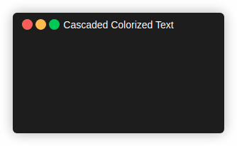

# Color Output for ANSI Terminals

This Go package provides support for colorized output
in terms of [ANSI Escape Codes](http://en.wikipedia.org/wiki/ANSI_escape_code#Colors).

The library consists of six basic APIs:
- [composition of output formats](#output-format-management)
- [enable colored output on `io.Writer` and `os.Stdout`](#managing-colorized-output).
- [compose colored strings](#managing-colorized-strings)
- [split formatted strings and scan their output format](#splitting-formatted-strings)
- [directly formatted Go strings](#plain-formatted-strings) (package `github.com/mandelsoft/ttycolors/plain`),
  usable as a standalone library
- [low-level ANSI escape sequence handling](#the-ansi-package) (package `github.com/mandelsoft/ttycolors/ansi`),
  usable as a standalone library

It supports the following ANSI output formats:
- output modes:
  - Bold/Dim/NonHighlighted
  - Italic
  - Underline (with optional styles double, curly, dotted and dashed)
  - Blinking
  - Reverse
  - Invisible
  - StrikeThrough
  - Overline (not supported, for example, by xterm and the Linux console)
- ANSI standard colors like Blue and Green, etc.
- ANSI color ids
- ANSI RGB color settings
- Foreground and Background Colors
- Bright Colors
- Underline Colors (optional)


The APIs support cascaded output format management.
Foreground and background colors as well as the output modes can be enabled and disabled independently.
It is possible to insert format statements into surrounding ones.
For every output mode there is a counterpart disabling the mode
(for example `NonItalic` or `FmtNonItalic`), which can be used to switch off
a mode for a part of a string formatted with this mode.

Some formats require [optional terminal features](#optional-terminal-features).

The main package `github.com/mandelsoft/ttycolors`
contains the management of native and composed 
output formats, the operation to colorize
an output stream according to those formats and
the composition of colored strings supporting cascaded format handling.

The package `github.com/mandelsoft/ttycolors/plain`
provides the output formats of the main package as functions
directly providing formatted Go strings
(see [Plain Formatted Strings](#plain-formatted-strings)).

The package `github.com/mandelsoft/ttycolors/ansi`
defines constants for the various ANSI escape codes and provides
low-level functions to create, scan and handle escape sequences
(see [The ANSI Package](#the-ansi-package)).

Executable [examples](#examples) are provided for all packages.

## Output Format Management

The package `github.com/mandelsoft/ttycolors`
provides constants for all native ANSI output formats:
- output modes, for example `FmtBold`.
  - `FmtBold`, `FmtDim` and `FmtNonHighlighted` are alternative values of the highlight mode.
  - `FmtItalic`, `FmtUnderline`, `FmtBlinking`, `FmtReverse`, `FmtInvisible`, `FmtStrikeThrough`, `FmtOverline`
    and their counterparts `FmtNonItalic`, `FmtNonUnderline`, `FmtNonBlinking`, `FmtNonReverse`,
    `FmtNonInvisible`, `FmtNonStrikeThrough`, `FmtNonOverline`.
  - underline styles `FmtDoubleUnderline`, `FmtCurlyUnderline`, `FmtDottedUnderline`, `FmtDashedUnderline`
    (requiring the feature `FeatureUnderlineStyles`).
- standard colors for foreground, background and bright colors, for example `FmtBlue`, `FmtBgBlue`, `FmtBrightBlue` or `FmtBgBrightBlue`.
- `FmtUncoloredFG` and `FmtUncoloredBG` reset the foreground or background color to the default
  color of the terminal, for example to remove the color of an outer format for a nested part.
- color ids using `FmtIdColor(id)` and `FmtBgIdColor(id)`
- underline colors using `FmtUnderlineIdColor(id)` and `FmtUnderlineRGBColor(r,g,b)`
  (requiring the feature `FeatureUnderlineColor`).
- RGB colors using `FmtRGBColor(r,g,b)` and `FmtBgRGBColor(r,g,b)`

All those constants provide the composition method `String(...)` usable to compose colored strings (type String).

With the function `New(fmt...)` new
formats can be composed based on any other format, for example `New(FmtBgWhite, FmtRed, FmtBold)`.
If multiple formats for the same mode or color are composed, the last one wins,
for example `New(FmtBold, FmtDim)` is dimmed.

### Examples

Predefined standard ANSI formats can be composed to new formats:

```golang
RedOnWhite := ttycolors.New(ttycolors.FmtBgWhite, ttycolors.FmtRed)
```

Those composed formats as well as the standard formats can be used to
create [colorized strings](#managing-colorized-strings)

```golang
str := RedOnWhite.String("red on white")
```
or to directly control an [output format](#managing-colorized-output):

```golang
ttycolors.Set(RedOnWhite, ttycolors.FmtBold)
```

## Managing colorized Output

The package `github.com/mandelsoft/ttycolors`
provides operations to apply output formats 
to `io.Writer` streams.
- `Set(fmt...) error` applies the format set to the standard output (`os.Stdout`)
- `SetFor(w, fmt...)` applies the format set to a dedicated writer (which should write to an ANSI terminal)
- `UnSet(fmt...) error` reverts the described settings for the standard output again. Output modes, foreground and background colors are handled separately.
- `UnSetFor(w, fmt...) error` reverts the described settings again for the given writer.

These functions use the settings of the default context (see [The Output Context](#the-output-context)),
which is enabled only if `os.Stdout` is a terminal. The same functions are offered as methods
by a `TTYContext`, which use the settings of the context instead, for example to write to
another writer:

```golang
ctx := ttycolors.NewContext(ttycolors.IsTerminal(os.Stderr))
ctx.SetFor(os.Stderr, ttycolors.FmtRed)
```

With `NewFormatter(fmt...)` a formatter for the given format is created.
It provides the usual methods for printing:
- Print
- Printf
- Sprint
- Sprintf
- Fprint
- Fprintf


### Examples

```golang
ttycolors.Set(ttycolors.FmtBgWhite, ttycolors.FmtRed)
fmt.Printf("red on white")
ttycolors.Set(ttycolors.FmtBlue)
fmt.Printf("blue on white")
ttycolors.UnSet(ttycolors.FmtBgWhite)
fmt.Printf("blue")
ttycolors.UnSet(ttycolors.FmtBlue)
fmt.Printf("\n")
fmt.Printf("back to normal\n")
```

The formatter can be used to apply a format.

```golang
f := ttycolors.NewFormatter(ttycolors.FmtBlue, ttycolors.FmtBold)
str := f.Sprint("an ", ttycolors.Italic("italic"), " string.")
# This is basically identical to
str = ttycolors.New(ttycolors.FmtBlue, ttycolors.FmtBold).String("an ", ttycolors.Italic("italic"), " string.").String()
```

As can be seen, the two APIs for colorized output are combinable

## Managing colorized Strings

The package `github.com/mandelsoft/ttycolors`
lets you compose colored strings.
The base type for such a string is `String`.
It can be rendered to a Go string using the `String() string` method.

The package provides functions for all
ANSI output formats providing an appropriate formatted `String` object.

- output modes, for example `Bold`, `Italic`, `NonItalic` or `CurlyUnderline`.
- standard colors for foreground, background and bright colors, for example `Blue`, `BgBlue`, `BrightBlue` or `BgBrightBlue`.
- `UncoloredFG` and `UncoloredBG` for the default foreground or background color of the terminal,
  for example `Blue("blue ", UncoloredFG("default"), " blue")`.
- color ids using `IdColor(id)` and `BgIdColor(id)`
- RGB colors using `RGBColor(r,g,b)` and `BgRGBColor(r,g,b)`
- underline colors using `UnderlineIdColor(id)` and `UnderlineRGBColor(r,g,b)`

Foreground and Background color settings as wells as the output modes are handled separately. This way the Strings added
to a formatting functions can locally use own
modes or colors independently of the surrounding settings.
For example, `Italic("an ", NonItalic("upright"), " word")` switches off italic
for the nested string and restores it afterwards.

Formats without any (non-empty) text are rendered without any escape sequence,
for example `Blue("a", Bold(), "b")` is rendered like `Blue("ab")`.
Escape sequences are only generated for changes of the output format,
for example `Italic("a", Italic("b"), "c")` is rendered like `Italic("abc")`.

Texts may contain already formatted strings, for example the result of
the `String()` method or the output of other tools. Output format sequences
embedded in such texts are tracked: after such a text, the output format
of the surrounding formats is established again, and formats left set by
the text are reset at the end.

```golang
red := ttycolors.Red("red").String()
s := ttycolors.Blue("a ", red, " blue")   // " blue" is still blue
```

Plain texts inherit the output format of the surrounding formats, the counterparts
(for example `NonItalic`, `NonHighlighted` or `UncoloredFG`) explicitly switch it off:

```golang
seq := ttycolors.Sequence(ttycolors.Italic("italic"), " inherits")
ttycolors.Italic(seq, " italic")  // " inherits" is italic
seq = ttycolors.Sequence(ttycolors.Italic("italic"), ttycolors.NonItalic(" upright"))
ttycolors.Italic(seq, " italic")  // " upright" is not italic
```

This difference is lost for already formatted strings: a rendered string describes
the output format for the default rendition and cannot express inheriting an outer format.
Therefore, `String` objects should be nested directly instead of their rendered strings,
whenever possible.

Texts are never modified: if colors are disabled, no escape sequences are
generated, but output format sequences embedded in texts are kept. Other control
sequences are not tracked. `StripIfDisabled(s)` (or the method of a context)
removes the output format sequences from a text, if colors are disabled for the
(default) context. It can be used for already formatted texts, whose formats should
only appear if the context enables colors, for example strings formatted by another
context or by package `plain`:

```golang
file := ttycolors.NewContext(false)
file.Blue("a ", file.StripIfDisabled(plain.Red("red")), " text") // "a red text"
```

`CharLen` provides the number of characters of a `String`, without rendering it.
`SplitAt` splits a `String` after a number of characters into two `String`s.
Both parts keep the structure of nested formats: a format containing the split
position is used for both parts, and plain texts still inherit the format of a
surrounding format. Therefore, the parts can be formatted independently:

```golang
first, second := ttycolors.Blue("progress").SplitAt(3)
ttycolors.Sequence(ttycolors.Reverse(first), second) // "pro" reversed, all blue
```

Already formatted texts embedded in a `String` are split like with `SplitAt`
(see [Splitting Formatted Strings](#splitting-formatted-strings)).

With the method `Sequence(text...)` a sequence of Strings can be created.
All composition functions accept an arbitrary list of elements, which are
concatenated without separators:

- Golang strings and byte slices are used as text. Output format sequences
  embedded in them are tracked (see above).
- `String` objects are nested structurally and rendered with the settings
  of the outermost `String`.
- All other types are converted to a string using `fmt.Sprintf("%v")`,
  for example, `fmt.Stringer` values provide their `String()` result.

### Examples

```golang
str := ttycolors.Blue("this blue text contains a ", ttycolors.Italic(ttycolors.Red("red"), " italic"), " word")
```

This expression provides a `ttycolors.String` object. In between, there is an italic part with a red word. All the rest is still blue.

A formal colorized string can be used as argument to all composition functions.
For example, with
```golang
str=str.Append(".")
```
it can be extended with a sequence of one or more strings.

To render such an object to a Golang string, the `String()` method can be called:

```golang
s:=str.String()
```

If colors are enabled, it contains the required ANSI escape sequences,
otherwise, the native text is returned.

Because of this method `String` objects can be directly passed to a
function of the `fmt.Printf` family.

For example,

```golang
fmt.Printf("%s\n", str)
```

outputs the color string to the standard output.

<p align="center">
  
</p>


A `String` object can be used to enable or disable coloring
by using the `Enable(b...)` method. The default coloring
is defined by the context used to create the string
(see [The Output Context](#the-output-context)).

The state of top level `String` object determines the color enablement, regardless what sublevel objects define.

## Splitting Formatted Strings

Within a `String`, every group of output formats (for example the foreground
color or italic) has one of three states at every position of the text:

- *untouched*: there is no format for the group, the text inherits the format of an outer format,
- *set*: a format sets a code for the group, for example `Italic(...)`,
- *explicitly reset*: a format switches the group off, for example `NonItalic(...)`.

Already formatted Go strings keep this information, as far as possible: groups without
output format sequences are untouched, groups switched off by a reset code are explicitly reset.

`SplitAt(s, n)` splits a formatted Go string after `n` characters into two
self-contained parts, which keep their output format, if they are embedded
or formatted independently:

- the first part resets the groups still set at the split position,
- the second part sets these groups again and resets the explicitly reset groups,
  untouched groups are not affected,
- output format sequences directly at the split position are replaced by these codes,
  other escape sequences there belong to the first part.

`SubString(s, start, end)` extracts the characters from `start` to `end-1` the same way.

```golang
s := ttycolors.Blue("progress").String()
first, second := ttycolors.SplitAt(s, 3)
ttycolors.Sequence(ttycolors.Reverse(first), second) // "pro" reversed, all blue
```

`ScanFormat(s)` provides the output format established at the end of a
formatted Go string as composed format: set groups use their code, explicitly reset
groups their reset code (like `FmtNonItalic` or `FmtUncoloredFG`), untouched groups
are not part of the format. It can be used to continue a formatted string or be
combined with other formats. Codes requiring a feature are handled like the
corresponding formats, for example, scanned underline styles require
`FeatureUnderlineStyles`.

```golang
f := ttycolors.ScanFormat(s)
ttycolors.Sequence(s, f.String(" continued with the format at the end of s"))
```

Codes not affecting an output format group, for example fonts, are not tracked.

## The Output Context

The package `github.com/mandelsoft/ttycolors` offers plain functions
or format constants for the string composition. They are based
on a default context, whose settings are the *global settings*.
The settings are described by a set of [features](#optional-terminal-features),
including the feature `FeatureFormatting`, which enables output formatting at all.

The global settings are initialized according to the capabilities of the
standard output: output formatting is enabled, if `os.Stdout` represents
a terminal device. Features, which cannot be detected, are disabled.
The global settings can be changed with the functions `SetFeatures`,
`EnableFeatures` and `DisableFeatures`, for example:

```golang
ttycolors.DisableFeatures(ttycolors.FeatureFormatting) // no output formatting at all
ttycolors.EnableFeatures(ttycolors.ExtendedFeatures)   // enable all features, which cannot be detected
```

The variable `NoColors` is the global switch for output formatting. It corresponds
to the absence of the feature `FeatureFormatting` in the global settings:
setting it to `true` disables output formatting, and disabling the feature
sets it to `true`.

Additionally, there is a `TTYContext` object offering the same functions as methods.
`DefaultContext()` provides the default context itself.
A new context created with `NewContext()` gets a copy of the global settings.
Later changes of the global settings do not affect it, and its settings can be changed
independently with the methods `SetFeatures`, `EnableFeatures`, `DisableFeatures`
and `Enable` (for output formatting). `NewContext(true)` and `NewContext(false)`
create a context with enabled or disabled output formatting.
A context created with `NewSharedContext()` instead shares the global settings
(or the settings of a context given as argument) until its settings are changed
for the first time: as long as it is unchanged, it follows the settings of its
base context, with the first change it gets a local copy and is independent afterwards.
The method `Share()` provides such a context for another context.

```golang
shared := ttycolors.NewSharedContext() // follows the global settings
shared.DisableFeatures(ttycolors.FeatureUnderlineColor) // now uses a local copy
```

The offered methods provide objects reflecting the settings of the context.
This also applies to its methods `Set`, `SetFor`, `UnSet` and `UnSetFor`,
which use the settings of the context instead of the settings of the given formats.

### Examples

```golang

ctx := ttycolors.NewContext(true) // provide a context always enabled

s := ctx.Blue("a blue text with some ", ctx.Italic("italic"), " word")
```

The crucial element here is the first call. It decided, whether coloring
is enabled or not. Subsequent elements derive this information.
Therefore, it could have been written as follows, also:

```golang
s := ctx.Blue("a blue text with some ", ttycolors.Italic("italic"), " word")
```

or

```golang
s := ctx.String(ttycolors.Blue("a blue text with some ", ttycolors.Italic("italic"), " word"))
```

## Optional Terminal Features

The output is controlled by features:

- `FeatureFormatting`: output formatting at all. Without this feature, no escape
  sequences are generated. Output format sequences embedded in texts are kept
  (see `StripIfDisabled`).
  It is enabled by default, if the standard output is a terminal.

Some output formats are not supported by all terminals. They require
an *extended feature* to be enabled. These features cannot be detected,
therefore they are disabled by default:

- `FeatureUnderlineStyles`: underline styles (double, curly, dotted, dashed).
  Without this feature, they are rendered as single underline.
  Terminals supporting underline styles do not necessarily support all of them.
  For example, GNOME Terminal (VTE 0.60) renders dotted and dashed underlines
  like curly underlines.
- `FeatureUnderlineColor`: underline colors.
  Without this feature, they are ignored.

These formats use sub parameters (for example `4:3`), which are put into
separate escape sequences. Terminals not supporting them typically ignore
them or show a single underline.

All other formats, including colors given by an id or RGB values, use
separate parameters (for example `38;5;3` instead of `38:5:3`), which
are supported by practically all terminals. Sub parameters are a later
addition, which is not supported, for example, by the Linux console,
GNU screen, older terminal emulators and many simple parsers in tools
and libraries. Some of them ignore such sequences completely, some
misinterpret them as other output modes. Sub parameters are therefore
only used, where a format cannot be expressed otherwise, and only with
an enabled feature.

The extended features are enabled globally with
`ttycolors.EnableFeatures(ttycolors.ExtendedFeatures)` (or a subset of them),
or for a context with its method `EnableFeatures`.
Strings, formats and formatters copy the features of their context when they are created,
later changes of the context do not affect them. They can be changed individually with
`EnableFeatures`, `DisableFeatures` and `SetFeatures`. `SetFeatures` sets the complete
feature set, including `FeatureFormatting`.
When rendering a string, the features of the outermost string are used for all nested strings.

```golang
ctx := ttycolors.NewContext()
ctx.EnableFeatures(ttycolors.ExtendedFeatures)

str := ctx.CurlyUnderline("a ", ctx.UnderlineIdColor(1, "spelling"), " error")
```

## Plain Formatted Strings

The package `github.com/mandelsoft/ttycolors/plain` offers the same
functions as the main package, but they directly provide formatted Go strings
instead of `String` objects. Composed formats are provided by `New(fmt...)`
as functions of the same kind (type `Func`). They accept the same elements
as the functions of the main package: Go strings (for example the results of other
`plain` functions), byte slices, `String` objects of the main package and
other values converted with `fmt.Sprintf("%v")`.

```golang
s := plain.Blue("a ", plain.Bold("bold"), " blue")

redItalic := plain.New(ttycolors.FmtRed, ttycolors.FmtItalic)
s = redItalic("a ", plain.Bold("bold"), " red italic")
```

The functions use the settings (enabled colors and features) of the
default context of the main package at the time they are called.
Therefore, they provide formatted strings only, if the standard output is a
terminal (or the global settings are changed). `For(ctx)` provides the same
functions as methods of a `Context` bound to a context of the main package.
They use the settings of this context at the time they are called, for
example to provide formatted strings for another output independently of
the global settings:

```golang
p := plain.For(ttycolors.NewContext(true))
s := p.Blue("a ", p.Bold("bold"), " blue")
red := p.New(ttycolors.FmtRed)
```

Because every call is rendered immediately, every string resets its
output format at its end. The surrounding calls track the output format
sequences embedded in such strings and establish their own output format
again afterwards. Therefore, nested calls work like in the main package,
but the resulting strings may contain more escape sequences than strings
composed with `String` objects.

The functions never modify their arguments, even if colors are disabled.
`StripIfDisabled(s)` removes the output format sequences from a string, if colors
are disabled for the default context.

The functions `SplitAt`, `SubString` and `ScanFormat` for formatted Go strings
(see [Splitting Formatted Strings](#splitting-formatted-strings)) are offered,
also. `ScanFormat` provides a format function:

```golang
first, second := plain.SplitAt(s, 3)
s = plain.Reverse(first) + second

s = s + plain.ScanFormat(s)(" continued with the format at the end of s")
```

## The ANSI Package

The package `github.com/mandelsoft/ttycolors/ansi` is used by the main package,
but can also be used as a standalone library. It does not know about
contexts, cascaded formats or optional features, it just provides the building blocks
for ANSI output format sequences (Select Graphic Rendition, `ESC [ ... m`)
and utility functions for strings containing such sequences.

### Escape Sequences

The parameter list of an escape sequence is described by a `CodeSequence`:

- A `Param` is a single numeric value, for example `1`.
  All output format constants, like `MODE_BOLD` or `COLOR_FG_RED`, are `Param`s.
- A `Code` is a sequence of `Param`s separated by `:` (sub parameters), for example `4:3`.
- A `CodeSequence` is a sequence of `Code`s separated by `;`, for example `1;38;5;3`.
  `Param` and `Code` are `CodeSequence`s themselves, others are created with
  `NewCodeSequence(params...)` and `Join(sequences...)`.
- A `Sequence` is the encoded byte sequence.

The functions `Mode(sequences...)` and `Modes(sequences...)` provide the escape
sequence for a list of `CodeSequence`s. `Modes` puts codes using sub parameters
into separate sequences (see [Optional Terminal Features](#optional-terminal-features)
for the reasons). `AppendMode` and `AppendModes` append them to a `Sequence`.
The functions `Code_FG_ID`, `Code_BG_ID`, `Code_FG_RGB`, `Code_BG_RGB`,
`Code_UL_ID` and `Code_UL_RGB` provide the code sequences for colors.

```golang
ansi.Mode(ansi.MODE_BOLD, ansi.COLOR_FG_RED)                         // "\x1b[1;31m"
ansi.Mode(ansi.Code_FG_ID(208), ansi.Code_BG_RGB(10, 20, 30))        // "\x1b[38;5;208;48;2;10;20;30m"
ansi.Modes(ansi.MODE_BOLD, ansi.UNDERLINE_CURLY, ansi.Code_UL_ID(1)) // "\x1b[1m\x1b[4:3m\x1b[58:5:1m"

seq := ansi.Join(ansi.MODE_ITALIC, ansi.Code_FG_ID(4))
seq.Bytes()                                                          // "3;38;5;4"
```

### Scanning Escape Sequences

- `ScanSequence(data)` detects a leading escape sequence and returns its byte length
  together with the output format areas affected by it (type `Covered`, for example
  `S_HIGHLIGHT`, `S_FG_COLOR` or `S_UNDERLINE`). All escape sequences of ECMA-48 are
  recognized (control sequences like cursor movements, control strings like window titles
  or hyperlinks, and other escape sequences). For sequences, which are no output format
  sequences, `S_CONTROL` is returned.
- `ScanSequenceEffect(data)` and `ScanEffect(s)` work like `ScanSequence` and `Scan`, but provide
  the effect (type `Effect`): the areas set to a value (`Set`) and the areas reset to the terminal
  default (`Reset`). The codes are applied in order, for example `ESC[1mbold ESC[22m` has the
  effect of resetting the highlight area.
- `Scan(s)` returns the union of the areas affected by all escape sequences in a string,
  including `S_CONTROL`, if other control sequences are found.
  A sequence resetting all modes (`ESC[0m` or `ESC[m`) affects all areas (`S_ALL`).
  Therefore, the result contains `S_ALL` for every string containing such a sequence.

### Strings with Escape Sequences

The following functions handle strings containing escape sequences
based on runes, ignoring all escape sequences:

- `CharLen(s)` provides the number of runes.
- `Strip(s)` removes all output format sequences, other control sequences are kept.
- `StripAll(s)` removes all escape sequences.
- `CharIndex(s, n)` and `CharIndexBefore(s, n)` provide the byte index of the n-th rune
  excluding or including the preceding escape sequences.
- `SplitAt(s, n)` splits a string after the n-th rune.
- `SubString(s, start, end)` extracts the runes from `start` to `end-1`.
- `ByteIndex(data, r)` provides the byte index of the first occurrence of a rune.

Negative indices cause a panic, indices beyond the end of the string are
truncated.

`SplitAt` and `SubString` cut the string without considering output formats.
The main package offers functions with the same names providing self-contained
parts, which keep their output format (see [Splitting Formatted Strings](#splitting-formatted-strings)).

`ScanCodes(s)` provides the codes of all output format sequences of a string
together with the affected output format areas.

```golang
s := ansi.Mode(ansi.MODE_BOLD, ansi.COLOR_FG_RED) + "Hällo" + ansi.Mode(ansi.MODE_RESET_ALL) + " world"

ansi.CharLen(s)              // 11
ansi.Strip(s)                // "Hällo world"
ansi.SubString(s, 1, 4)      // "äll"
ansi.SplitAt(s, 5)           // "\x1b[1;31mHällo\x1b[0m", " world"
ansi.ScanSequence([]byte(s)) // 7, ansi.S_HIGHLIGHT|ansi.S_FG_COLOR
ansi.Scan(s)                 // ansi.S_ALL, because ESC[0m resets all areas
```

### Limitations

- Only the 7-bit forms of escape sequences are recognized. The 8-bit forms of the control
  functions (for example `0x9B` for CSI) are treated as text, because those bytes are used
  by UTF-8 encoded characters.
- Escape sequences, which are no output format sequences (for example cursor movements),
  are only recognized as such (`S_CONTROL`). Their effect on the terminal is not interpreted.
- The scanner maps code 21 (`MODE_DOUBLE_UNDERLINE`) to `S_UNDERLINE` (doubly underlined according to ECMA-48).
  Some terminals, for example the Linux console, interpret it as resetting bold, instead.
- The scanner cannot interpret parameters following an extended color (38, 48, 58)
  with an unknown color kind, they are ignored.
- Sub parameters (for example `4:3`) are not supported by all terminals
  (see [Optional Terminal Features](#optional-terminal-features)).

## Examples

The folder [`examples`](examples) contains executable examples, structured
according to the packages. They can be executed with `go run`, for example
`go run ./examples/ttycolors/strings`.

| Example | Description | Demo |
|---|---|---|
| [`ttycolors/strings`](examples/ttycolors/strings/main.go) | composition of colored strings with cascaded formats | [demo](examples/ttycolors/strings/demo.gif) |
| [`ttycolors/formats`](examples/ttycolors/formats/main.go) | composed formats, formatters and the output format of writers | [demo](examples/ttycolors/formats/demo.gif) |
| [`ttycolors/context`](examples/ttycolors/context/main.go) | output contexts, optional terminal features and other writers | [demo](examples/ttycolors/context/demo.gif) |
| [`ttycolors/embedded`](examples/ttycolors/embedded/main.go) | embedding already formatted strings | [demo](examples/ttycolors/embedded/demo.gif) |
| [`ttycolors/underline`](examples/ttycolors/underline/main.go) | underline styles and underline colors |  |
| [`plain`](examples/plain/main.go) | directly formatted Go strings | [demo](examples/plain/demo.gif) |
| [`ansi/codes`](examples/ansi/codes/main.go) | creation of escape sequences | [demo](examples/ansi/codes/demo.gif) |
| [`ansi/scanner`](examples/ansi/scanner/main.go) | scanning of escape sequences | [demo](examples/ansi/scanner/demo.gif) |
| [`ansi/strings`](examples/ansi/strings/main.go) | handling of strings containing escape sequences | [demo](examples/ansi/strings/demo.gif) |

The examples of package `ansi` and the example `ttycolors/embedded` print
the used code together with its results as comments, for example:

```golang
ansi.Mode(ansi.MODE_BOLD, ansi.COLOR_FG_RED)                         // "\x1b[1;31m"
ansi.Modes(ansi.MODE_BOLD, ansi.UNDERLINE_CURLY, ansi.Code_UL_ID(1)) // "\x1b[1m\x1b[4:3m\x1b[58:5:1m"
```

The other examples print colored output, if the standard output is a terminal.

The demo GIFs are generated with `make gifs`, the GIF for a single example with
`hack/demo-gif.sh <example>` (see [`hack/demo-gif.sh`](hack/demo-gif.sh)). Generating them
requires `bash`, `jq`, `script` and [terminalizer](https://github.com/faressoft/terminalizer).
The terminalizer configuration (window, font and colors) is taken from
[`hack/terminalizer.json`](hack/terminalizer.json).
The terminal emulation used by terminalizer supports neither underline styles nor
underline colors, therefore there is no demo for the example `ttycolors/underline`.

